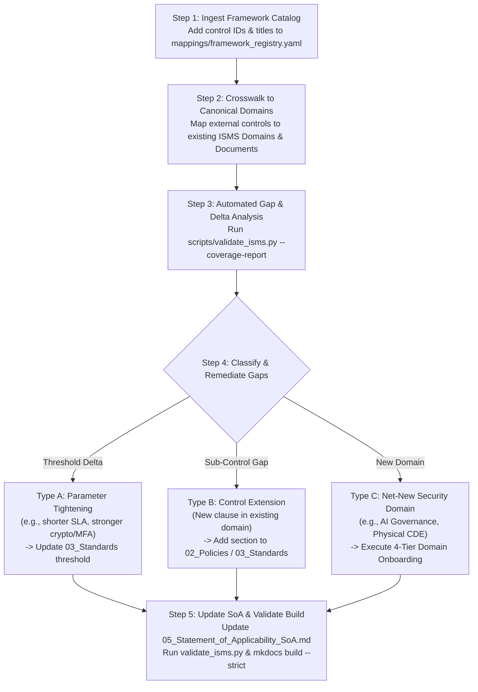

# Framework and Domain Onboarding Guide

| Attribute | Value |
| :--- | :--- |
| **Document ID** | ISMS-GD-01 |
| **Version** | 1.0 |
| **Effective Date** | [INSERT_DATE] |
| **Document Owner** | [CISO_NAME] / Compliance Lead |
| **Review Cycle** | Annual |
| **Classification** | Internal |
| **Framework Mappings** | ISO/IEC 27001:2022 (Clause 4.1, 4.2, 4.3), SOC 2 TSC (CC1.1, CC2.1), NIST CSF 2.0 (GV.OC-01, GV.PO-01), GDPR (Art. 24) |

## 1. Overview and Architecture
This guide defines [COMPANY_NAME]'s Compliance-as-Code onboarding architecture and operational roadmap for rapidly expanding the Information Security Management System (ISMS) across emerging regulatory frameworks and security domains.

### 1.1 Canonical Control Hub-and-Spoke Model
Rather than maintaining siloed, duplicated policies for each audit framework (e.g. ISO 27001, SOC 2, NIST CSF, PCI DSS), [COMPANY_NAME] employs a centralized **Canonical Control Hub-and-Spoke** architecture:
- **Canonical Control Hub (`CC-XX-YY`):** Internal, unified controls representing the organization's definitive operational security mandates across 14 domains (`GV`, `AM`, `AC`, `CR`, `PS`, `OP`, `CS`, `SR`, `HR`, `DP`, `IR`, `BC`, `SD`, `AU`).
- **External Framework Spokes:** Mappings from canonical controls to external control frameworks, including ISO/IEC 27001:2022 Annex A, AICPA SOC 2 (2017/2022 TSC), NIST CSF 2.0, and GDPR.
- **Repository Implementing Layer:** Direct linkages to the authoritative Markdown policies, standards, procedures, and evidence registers within `docs/`.

```mermaid
flowchart LR
    subgraph Frameworks["External Control Frameworks (Spokes)"]
        ISO["ISO/IEC 27001:2022 (93 Controls)"]
        SOC2["AICPA SOC 2 TSC (2017/2022)"]
        GDPR["GDPR / Privacy Laws"]
        NIST["NIST CSF 2.0 / SP 800-53"]
        CIS["CIS Controls v8.1 / Essential 8"]
        SECTOR["Sector Frameworks (PCI DSS 4.0.1, HIPAA, NIS2, DORA, ISO 42001)"]
    end

    subgraph Hub["Canonical Control Registry (Hub)"]
        YAML["mappings/framework_registry.yaml"]
        VAL["scripts/validate_isms.py"]
    end

    subgraph Docs["4-Tier ISMS Documentation"]
        T1["Tier 1: ISMS Framework & SoA (01_ISMS_Framework)"]
        T2["Tier 2: Domain Policies (02_Policies)"]
        T3["Tier 3: Technical Standards & Playbooks (03_Standards_and_Procedures)"]
        T4["Tier 4: Operational Evidence Registers (04_Templates_and_Registers)"]
    end

    Frameworks --> YAML
    YAML --> VAL
    VAL --> T1
    T1 --> T2
    T2 --> T3
    T3 --> T4
```

## 2. 5-Step SOP for Onboarding New Control Frameworks
When expanding compliance scope to integrate a new standard (e.g., CIS Controls v8.1, Essential Eight, PCI DSS v4.0.1, HIPAA Security Rule, EU NIS2/DORA, or ISO/IEC 42001):

### Step 1: Framework Intake and Deconstruction
- Ingest the official framework specification into structured data (`mappings/framework_registry.yaml`).
- Catalog all external control identifiers, descriptions, and evaluation requirements.

### Step 2: Gap Analysis & Canonical Mapping
- Map each external requirement against existing canonical controls in `mappings/framework_registry.yaml` (leveraging official crosswalks such as NIST CSF 2.0 Informative References or CIS-to-ISO 27001:2022 mappings first).
- Identify unmapped or partially met controls ("spokes without hubs") and classify every delta into one of three remediation types:

| Gap Type | Description | Example | Required Action |
| :--- | :--- | :--- | :--- |
| **Type A: Parameter Tightening** | Control exists in the ISMS, but the new framework mandates a stricter numeric threshold or cadence. | PCI DSS v4.0.1 requiring 90-day inactive account disablement; NIS2 requiring 24-hour early warning. | Tighten the baseline threshold in `03_Standards_and_Procedures/` to the **"Strictest Common Denominator" (Watermarking)** or add a tiered parameter row. |
| **Type B: Control Extension** | Requirement fits naturally within an existing ISMS policy domain but adds a new sub-clause. | DORA ICT third-party concentration risk under Supplier Security (`07_Supplier_Security_Policy.md`). | Add a numbered subsection (`3.x`) to the existing policy/standard and map it in `mappings/framework_registry.yaml`. |
| **Type C: Net-New Security Domain** | Framework introduces an entirely new domain not covered by an existing policy. | AI Management System (`ISO/IEC 42001`), Cardholder Data Environment (`PCI DSS`), or OT/IoT Security. | Execute the **4-Tier Security Domain Onboarding Pattern** in Section 3 below. |

### Step 3: Policy and Standard Authoring / Amendment
- Amend existing policies or author new domain standards to fulfill identified control gaps.
- Ensure all new documents incorporate standardized Document Control Header Tables and Document History Tables.

### Step 4: Statement of Applicability & Crosswalk Expansion
- Update the [Statement of Applicability (SoA)](05_Statement_of_Applicability_SoA.md) and crosswalk tables with clickable links to the implementing artifacts.

### Step 5: Automated Verification and CI Gate
- Execute `python scripts/validate_isms.py --coverage-report --strict` and `mkdocs build --strict` to verify link integrity, nav parity, and 100% control mapping.

## 3. 4-Tier Pattern for Onboarding New Security Domains
When introducing a new technical domain (e.g., Artificial Intelligence / LLM Security, Cloud-Native Container Security, OT/IoT Security), every domain must be onboarded across all four ISMS tiers so management intent, technical baselines, and audit evidence remain coupled:

| ISMS Tier | Directory | Artifact to Create / Update | Purpose & Audit Role |
| :--- | :--- | :--- | :--- |
| **Tier 1: Governance & Risk** | `docs/01_ISMS_Framework/` | [Context of the Organization](02_Context_of_the_Organization.md), [Roles and Responsibilities](04_Roles_and_Responsibilities.md), and [Statement of Applicability (SoA)](05_Statement_of_Applicability_SoA.md) | Defines why the domain is in scope, who owns it, and how its controls map to the SoA. |
| **Tier 2: Policy ("What & Why")** | `docs/02_Policies/` | `NN_<Domain>_Security_Policy.md` (e.g., [Acceptable Use and AI Security Policy](../02_Policies/13_Acceptable_Use_and_AI_Security_Policy.md)) | High-level management mandate (technology-agnostic, reviewed annually). |
| **Tier 3: Standard / Procedure ("How & Thresholds")** | `docs/03_Standards_and_Procedures/` | `NN_<Domain>_Standard.md` or `NN_<Domain>_Procedure.md` | Measurable technical baselines, SLAs, architecture rules, and step-by-step runbooks. |
| **Tier 4: Register / Template ("Audit Evidence")** | `docs/04_Templates_and_Registers/` | `NN_<Domain>_Register.md` or extend [Information Asset Register](../04_Templates_and_Registers/01_Information_Asset_Register.md) / [Risk Register](../04_Templates_and_Registers/02_Risk_Register.md) | Captures recurring operational records required by external auditors. |

## 4. 3-Horizon Compliance Roadmap

| Horizon | Timeline | Objectives & Overlap | Target Frameworks & Domains |
| :--- | :--- | :--- | :--- |
| **Horizon 1 (Core Baseline)** | Current Baseline (~100% Implemented) | Foundation ISMS with full CI/CD validation, 93-control SoA, AI Acceptable Use, and Internal Audit/CAPA governance. | **ISO/IEC 27001:2022**, **AICPA SOC 2 (2017/2022 TSC)**, **NIST CSF 2.0**, **EU/UK GDPR**, **NIST SP 800-63B & 800-88 Rev. 1** |
| **Horizon 2 (Cyber Resilience)** | Months 3–6 (~80% Structural Overlap) | Technical hardening baselines, endpoint application control, and Zero Trust architecture parameters. | **CIS Controls v8.1** (IG1–IG3), **ACSC Essential Eight**, **OWASP ASVS v4/v5 & SAMM**, **NIST SP 800-207 (ZTA)** |
| **Horizon 3 (Sector & Specialized)** | Months 6–12 (Modular Opt-In Packs) | Sector-specific and specialized management system overlays (`docs/05_Sector_Modules/`). | **ISO/IEC 42001:2023 & NIST AI RMF**, **ISO/IEC 27701 (PIMS)**, **PCI DSS v4.0.1**, **HIPAA**, **EU NIS2 & DORA**, **FedRAMP / NIST SP 800-53 Rev. 5** |

## 5. Related Documents
- [Statement of Applicability (SoA)](05_Statement_of_Applicability_SoA.md)
- [ISMS Governance, Audit, and Continual Improvement](06_ISMS_Governance_Audit_and_Improvement.md)
- [Risk Management Methodology](03_Risk_Management_Methodology.md)
- [Acceptable Use and AI Security Policy](../02_Policies/13_Acceptable_Use_and_AI_Security_Policy.md)

## Document History

| Version | Date | Author | Approved By | Description |
| :--- | :--- | :--- | :--- | :--- |
| 1.0 | [INSERT_DATE] | [AUTHOR_NAME] | [CISO_NAME] | Initial release and harmonization |
